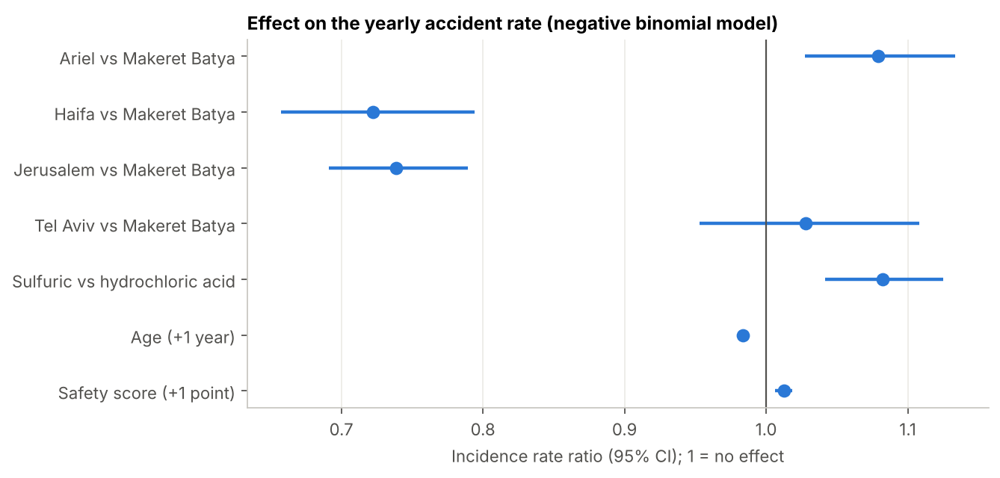
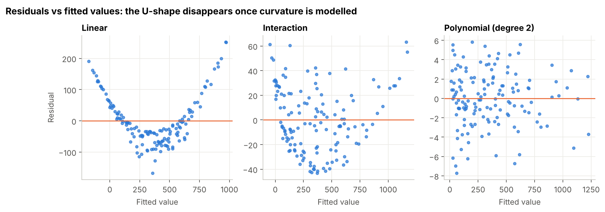
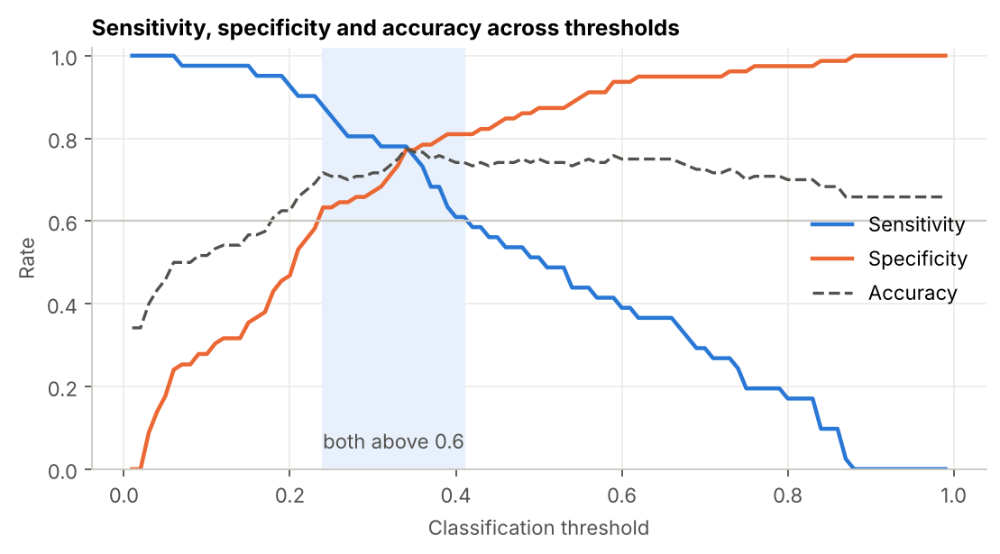

# Regression Analysis for Safety Management

Three regression problems from an industrial safety setting, each solved with the model its outcome calls for:

| # | Outcome | Model | Notebook |
|---|---|---|---|
| 1 | Machine performance (continuous) | Linear, interaction and polynomial OLS | [01_linear_interaction_polynomial](notebooks/01_linear_interaction_polynomial.ipynb) |
| 2 | Which acid a residue is (binary) | Logistic regression | [02_logistic_classification](notebooks/02_logistic_classification.ipynb) |
| 3 | Workplace accidents per worker (count) | Poisson and negative binomial with an exposure offset | [03_count_models_accidents](notebooks/03_count_models_accidents.ipynb) |

The project started as a university regression course assignment, which I completed on my own. This is a revised version: it rechecks the original conclusions and corrects two of them (see [What changed from the first version](#what-changed-from-the-first-version)).

## Key findings

| # | Finding | Number |
|---|---|---|
| 1 | Machine performance is a quadratic function of temperature and humidity | Test RMSE 76.8 (linear) → 28.2 (interaction) → 2.8 (degree 2); AIC and BIC are lowest at degree 2 |
| 2 | Humidity matters more than temperature, and more so when it is warm | +1 humidity adds 12 at 10° and 21 at 30° |
| 3 | Lumps in the residue are the strongest sign of sulfuric acid | Odds ratio 0.13 for hydrochloric; AUC 0.82 |
| 4 | The best threshold is well below 0.5 | 0.34 gives accuracy 0.775, vs 0.658 for always guessing the majority class |
| 5 | Accident counts are overdispersed, so Poisson regression understates uncertainty | Dispersion ratio 3.4; negative binomial cuts AIC from 54,658 to 45,883 |
| 6 | Factory is the strongest driver of accidents | Haifa and Jerusalem about 26% to 28% fewer accidents per year than Makeret Batya |
| 7 | Higher safety test scores go with slightly *more* accidents | +1.2% per point; not explained by factory or chemical |



## Approach

**Accidents as a rate, not a count.** Workers have been in their factory for 1 to 10 years, so a raw count mostly measures time. The count models use `log(years in factory)` as an offset and model accidents per year. The offset assumption is then tested by estimating its coefficient instead of fixing it at 1.

**Four checks before trusting Poisson.** Mean vs variance within groups of similar predicted risk, the share of Pearson residuals within ±2, the dispersion ratio, and a chi-square goodness-of-fit test. All four reject the Poisson assumption, which leads to the negative binomial model.

**Model selection on held-out data.** The linear models are compared by AIC, BIC and error on a 30% test set.





## What changed from the first version

| Topic | First version | This version |
|---|---|---|
| Experience and accidents | Concluded that more years in the factory means more accidents | That was forced by the offset. Testing it gives a coefficient of 0.94 (95% CI 0.91 to 0.97): the yearly rate falls slightly with experience |
| Safety score paradox | Suggested that riskier environments lead to more training and higher scores | Scores are almost identical across factories and chemicals, so that explanation does not hold. Reverse causality (training after accidents) is more plausible |
| Model comparison | Final comparison fitted on the full dataset | All models fitted on the training set only |
| Heteroscedasticity | Treated as a separate problem in the linear model | It disappears in the polynomial model (Breusch-Pagan p = 0.70), so it was caused by the wrong functional form |
| Classifier | Accuracy only | Adds AUC, the majority-class baseline and odds ratios; corrects the definition of specificity |
| Log-odds derivation | Sign error in the probability formula | Corrected and verified numerically |
| Structure | One notebook per course submission, in Hebrew | One English notebook per problem; originals kept in `notebooks/archive/` |

## Data limitations

- All three datasets are synthetic, generated for the course. The near-perfect fit in problem 1 (test R² 0.9999) reflects that, and would be a warning sign in real data.
- Problem 2 has only 120 samples and the assignment evaluated the classifier on the data it was fitted on, so the threshold results are optimistic.
- Problem 3 records only the total accidents per worker, with no dates. That is why the direction of the safety score effect cannot be tested.

## Repository structure

```
Regression-Analysis-for-Safety-Management/
├── README.md
├── requirements.txt
├── data/
│   ├── machine_performance.csv
│   ├── acid_classification.csv
│   ├── workplace_accidents.csv
│   └── README.md                    Column descriptions
├── notebooks/
│   ├── 01_linear_interaction_polynomial.ipynb
│   ├── 02_logistic_classification.ipynb
│   ├── 03_count_models_accidents.ipynb
│   └── archive/                     Original Hebrew notebooks
└── images/                          Charts used in this README
```

## How to run

```bash
pip install -r requirements.txt
cd notebooks
jupyter lab
```

## Tools

Python, pandas, NumPy, statsmodels, scikit-learn, SciPy, Matplotlib, Jupyter.

## Credits

Analysis by Nir Avrahamoff. Datasets provided by the university course.
